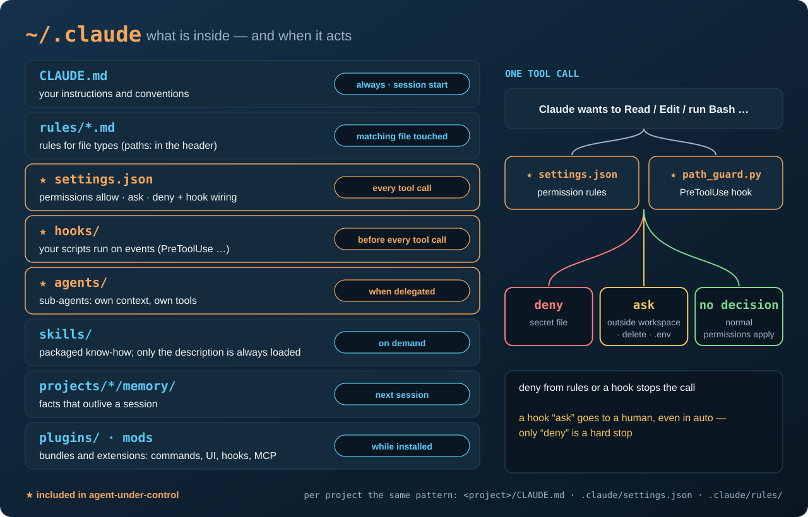

# 🛡️ agent-under-control — guardrails for Claude Code on Windows

[]()
[]()
[]()
[](tests/cases.json)
[]()
[](LICENSE)

> 🎯 You gave an AI agent access to your work. These hooks decide what it may touch without asking, what needs your
> explicit "yes", and what it can never read — not even through a shell. 🇵🇱 [Wersja polska](README_PL.md)



## 🤔 Why

Claude Code has a good permission system. Three things in practice still slip through:

1. **Auto mode approves `ask` on its own** when a request looks obvious. Only `deny` is a hard stop.
2. **`deny Read(...)` is a rule for the Read tool.** For a shell command such as `cat ~/.ssh/id_ed25519` it is not
   something you can count on — so the hook checks the command text itself.
3. **A hook that cannot start disappears silently.** A hook called as plain `python` stops working after a PATH change
   and nobody notices, because hook errors do not block the tool.

This repository closes those three gaps with two small hooks, one read-only agent and a settings skeleton.
It comes from a real audit of a working setup (Oracle/PostgreSQL DBA work and video production with Claude Code).

## 📦 What's inside

| Path | What it does |
|---|---|
| [`hooks/path_guard.py`](hooks/path_guard.py) | `PreToolUse` hook for every file tool and both shells: **deny** secret files, **ask** outside your workspaces and before any deletion |
| [`hooks/path_guard.config.example.json`](hooks/path_guard.config.example.json) | your workspaces, audit log location, extra deny patterns |
| [`hooks/readonly_bash_guard.py`](hooks/readonly_bash_guard.py) | allow-list for Bash: only read-only commands (`git log/show/diff`, `grep`, `cat`…) |
| [`agents/docs-auditor.md`](agents/docs-auditor.md) | sub-agent that checks whether docs still match the code; its Bash is locked by the guard above |
| [`settings/settings.example.json`](settings/settings.example.json) | `deny` / `ask` rules and the hook wiring (with a full Python path) |
| [`tests/`](tests) | 32 cases: hook input → expected decision; runs without Claude Code |
| [`install/install.ps1`](install/install.ps1) | installer with `-DryRun`, backup and a non-destructive `settings.json` merge |
| [`docs/AUDIT_CHECKLIST.md`](docs/AUDIT_CHECKLIST.md) | how to review your own Claude Code setup |

## ⚖️ How `path_guard` decides

| # | Situation | Decision |
|---|---|---|
| 0 | SSH private key (not `.pub`), Claude/Gemini/Docker/DBeaver/pgAdmin credentials, your `extra_hard_deny` patterns — in **any** tool | **deny** |
| 1 | a path outside your workspaces (Read, Edit, Grep, a path inside a shell command, a path inside a script being run) | **ask** |
| 2 | file deletion (`rm`, `Remove-Item`, `del`, `git clean`, `git reset --hard`, `shutil.rmtree`…), also inside a workspace | **ask** |
| 2a | `.env` files (templates such as `.env.example` are fine) | **ask** |
| 2b | a script being run that contains outside paths or computes profile paths (`Path.home()`, `%APPDATA%`) | **ask** |
| 3 | anything else | no decision — Claude Code's normal permissions apply |

Exceptions: Claude Code's own memory, plans and scratchpad; **reading** `~/.claude/rules`. Every `ask` and `deny` is written
to a JSONL audit log. A hook error never blocks your work (fail-open) — it is logged instead.

## 🚀 Install

### 🤖 Scripted path (automatic)

Requirements: Windows 10/11, PowerShell 7+, Python 3.10+.

```powershell
git clone https://github.com/krzysztof-i-cabaj/agent-under-control
cd agent-under-control
pwsh install/install.ps1 -DryRun     # preview: what would be copied, added, kept - changes nothing
pwsh install/install.ps1             # install (backup first, then copy, merge, run the tests)
```

What the installer does:

1. finds Python (refuses the Microsoft Store alias) or takes `-Python "C:/path/to/python.exe"`;
2. backs up existing files to `~/.claude/backups/agent-under-control-<timestamp>/`;
3. copies both hooks to `~/.claude/hooks/` and writes the agent with full paths filled in;
4. creates `~/.claude/path_guard.config.json` from the example **only if it does not exist**;
5. **merges** `settings.json`: adds missing `deny`/`ask` rules and the hook entry; keeps everything else; never duplicates;
6. runs the tests.

Then edit `workspaces` in `~/.claude/path_guard.config.json` and start a **new** Claude Code session.
Another Claude directory: `-ClaudeDir D:\other\.claude`.

### ✋ Manual path

1. Copy `hooks/path_guard.py` and `hooks/readonly_bash_guard.py` to `%USERPROFILE%\.claude\hooks\`.
2. Copy `hooks/path_guard.config.example.json` to `%USERPROFILE%\.claude\path_guard.config.json` and set your `workspaces`.
3. Copy `agents/docs-auditor.md` to `%USERPROFILE%\.claude\agents\` and replace `__PYTHON__` with the full path to
   `python.exe` and `__HOOKS_DIR__` with `C:/Users/<you>/.claude/hooks` (forward slashes).
4. Open `%USERPROFILE%\.claude\settings.json` and add from `settings/settings.example.json`: the `deny` and `ask` rules
   you do not have yet, and the `hooks.PreToolUse` entry (same two replacements in `command`). Keep your other settings.
5. Check: `python tests/run_tests.py` → `32/32 passed`. Start a new Claude Code session.

## ⚙️ Configuration

`path_guard` reads the first file it finds: `PATH_GUARD_CONFIG` (environment variable), `path_guard.config.json`
next to the hook, one level up, or in `~/.claude/`.

```json
{
  "workspaces": ["D:/work", "~/projects"],
  "audit_log": "~/.claude/logs/path_guard_audit.jsonl",
  "extra_hard_deny": ["\\.aws[/\\\\]credentials", "\\.kube[/\\\\]config"]
}
```

No config at all: the session's project directory is the only workspace, and the log goes to `~/.claude/logs/`.

## 🧪 Tests

```powershell
python tests/run_tests.py
```

Each case in [`tests/cases.json`](tests/cases.json) feeds a hook the same JSON that Claude Code would, and checks the decision.
Add a case whenever you add a rule.

## ↩️ Rollback

The installer saves every file it touches to `~/.claude/backups/agent-under-control-<timestamp>/`. To undo: copy those
files back to `~/.claude/` (and `hooks/`, `agents/`), delete the two hook files and the agent if they were new,
then start a new Claude Code session. Manual install: remove the `hooks.PreToolUse` entry from `settings.json`.

## ⚠️ Limits — read before you rely on it

- **Not a sandbox.** It is a guard for an honest agent making mistakes, not a security boundary against a hostile one.
  A path assembled at runtime, an encoded command or a tool it does not know about will pass.
- **Windows-first.** Paths are normalized the Windows way (`C:/…`, Git Bash `/c/…`). Linux and macOS are untested.
- **Fail-open by design.** If the hook crashes, your work continues and the error is logged. Check the log now and then.
- **Masking secrets in tool output** is not part of this repository — it needs a Claude Code extension, shown in the series.

## 🎬 Series

These guardrails are shown step by step in the video series **„Agent pod kontrolą”** (Polish, English subtitles)
on the [KCB Consulting](https://www.youtube.com/@KCB_Consulting) YouTube channel.

## 👤 Author

Krzysztof Cabaj · KCB Consulting · License: [MIT](LICENSE)
