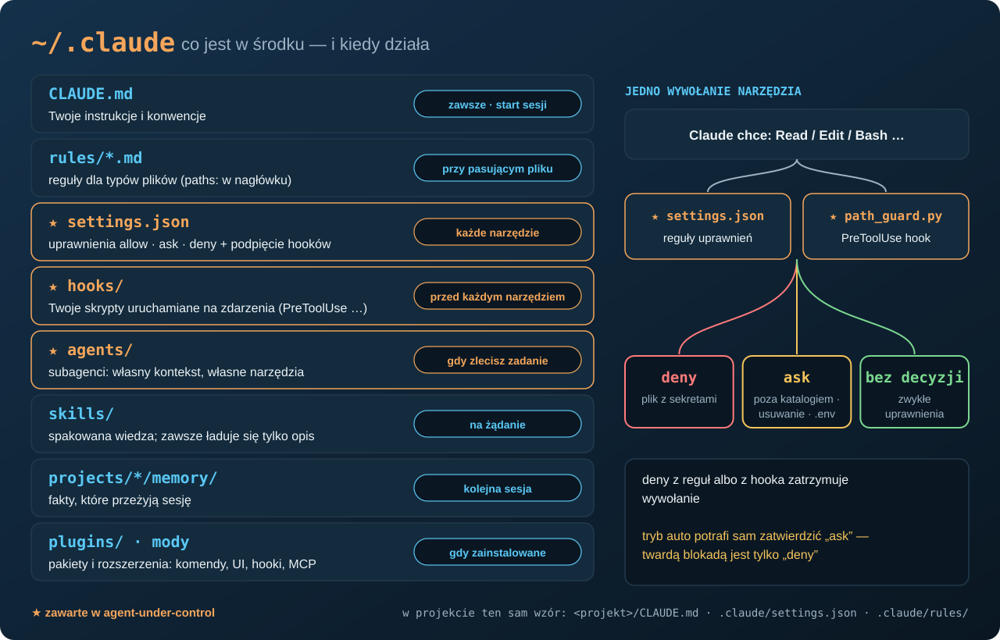

# 🛡️ agent-under-control — hamulce dla Claude Code na Windows

[]()
[]()
[]()
[](tests/cases.json)
[]()
[](LICENSE)

> 🎯 Dałeś agentowi AI dostęp do swojej pracy. Te hooki decydują, czego może dotknąć bez pytania, na co potrzebuje
> Twojego „tak”, a czego nie przeczyta nigdy — nawet przez shell. 🇬🇧 [English version](README.md)



## 🤔 Po co

Claude Code ma dobry system uprawnień. W praktyce i tak przeciekają trzy rzeczy:

1. **Tryb auto sam zatwierdza `ask`**, gdy prośba wygląda na oczywistą. Twardą blokadą jest tylko `deny`.
2. **`deny Read(...)` to reguła dla narzędzia Read.** Dla polecenia w shellu, np. `cat ~/.ssh/id_ed25519`, nie można
   na niej polegać — dlatego hook sprawdza sam tekst polecenia.
3. **Hook, który się nie uruchomi, znika po cichu.** Hook wołany gołym `python` przestaje działać po zmianie PATH
   i nikt tego nie zauważa, bo błąd hooka nie blokuje narzędzia.

To repozytorium zamyka te trzy luki: dwa małe hooki, jeden agent tylko do odczytu i szkielet ustawień.
Powstało z audytu działającej konfiguracji (praca DBA Oracle/PostgreSQL i produkcja wideo z Claude Code).

## 📦 Zawartość

| Ścieżka | Co robi |
|---|---|
| [`hooks/path_guard.py`](hooks/path_guard.py) | hook `PreToolUse` dla wszystkich narzędzi plikowych i obu shelli: **deny** dla plików z sekretami, **ask** poza katalogami roboczymi i przed każdym usuwaniem |
| [`hooks/path_guard.config.example.json`](hooks/path_guard.config.example.json) | katalogi robocze, miejsce logu, dodatkowe wzorce deny |
| [`hooks/readonly_bash_guard.py`](hooks/readonly_bash_guard.py) | biała lista dla Bash: tylko polecenia do odczytu (`git log/show/diff`, `grep`, `cat`…) |
| [`agents/docs-auditor.md`](agents/docs-auditor.md) | subagent (po angielsku) sprawdzający, czy dokumentacja zgadza się z kodem; jego Bash pilnuje hook wyżej |
| [`settings/settings.example.json`](settings/settings.example.json) | reguły `deny` / `ask` i podpięcie hooka (z pełną ścieżką Pythona) |
| [`tests/`](tests) | 32 przypadki: wejście hooka → oczekiwana decyzja; działa bez Claude Code |
| [`install/install.ps1`](install/install.ps1) | instalator z `-DryRun`, kopią zapasową i scaleniem `settings.json` bez nadpisywania |
| [`docs/AUDIT_CHECKLIST_PL.md`](docs/AUDIT_CHECKLIST_PL.md) | jak przejrzeć własną konfigurację Claude Code |

## ⚖️ Jak decyduje `path_guard`

| # | Sytuacja | Decyzja |
|---|---|---|
| 0 | prywatny klucz SSH (nie `.pub`), dane logowania Claude/Gemini/Docker/DBeaver/pgAdmin, Twoje wzorce `extra_hard_deny` — w **dowolnym** narzędziu | **deny** |
| 1 | ścieżka poza katalogami roboczymi (Read, Edit, Grep, ścieżka w poleceniu shella, ścieżka w uruchamianym skrypcie) | **ask** |
| 2 | usuwanie plików (`rm`, `Remove-Item`, `del`, `git clean`, `git reset --hard`, `shutil.rmtree`…), także w katalogu roboczym | **ask** |
| 2a | pliki `.env` (szablony typu `.env.example` są w porządku) | **ask** |
| 2b | uruchamiany skrypt ze ścieżkami spoza katalogów roboczych albo wyliczający ścieżki profilu (`Path.home()`, `%APPDATA%`) | **ask** |
| 3 | wszystko inne | bez decyzji — działają zwykłe uprawnienia Claude Code |

Wyjątki: pamięć, plany i scratchpad samego Claude Code; **odczyt** `~/.claude/rules`. Każde `ask` i `deny` trafia do logu
JSONL. Błąd hooka nigdy nie blokuje pracy (fail-open) — zostaje zapisany w logu.

## 🚀 Instalacja

### 🤖 Ścieżka skryptowa (automatycznie)

Wymagania: Windows 10/11, PowerShell 7+, Python 3.10+.

```powershell
git clone https://github.com/krzysztof-i-cabaj/agent-under-control
cd agent-under-control
pwsh install/install.ps1 -DryRun     # podgląd: co zostanie skopiowane, dodane, zostawione - nic nie zmienia
pwsh install/install.ps1             # instalacja (kopia zapasowa, kopiowanie, scalenie, testy)
```

Co robi instalator:

1. znajduje Pythona (odrzuca alias z Microsoft Store) albo bierze `-Python "C:/sciezka/python.exe"`;
2. kopiuje istniejące pliki do `~/.claude/backups/agent-under-control-<znacznik czasu>/`;
3. kopiuje oba hooki do `~/.claude/hooks/` i zapisuje agenta z wpisanymi pełnymi ścieżkami;
4. tworzy `~/.claude/path_guard.config.json` z przykładu **tylko wtedy, gdy go nie ma**;
5. **scala** `settings.json`: dodaje brakujące reguły `deny`/`ask` i wpis hooka; resztę zostawia; niczego nie dubluje;
6. uruchamia testy.

Potem ustaw `workspaces` w `~/.claude/path_guard.config.json` i uruchom **nową** sesję Claude Code.
Inny katalog Claude: `-ClaudeDir D:\inny\.claude`.

### ✋ Ścieżka ręczna

1. Skopiuj `hooks/path_guard.py` i `hooks/readonly_bash_guard.py` do `%USERPROFILE%\.claude\hooks\`.
2. Skopiuj `hooks/path_guard.config.example.json` jako `%USERPROFILE%\.claude\path_guard.config.json` i ustaw `workspaces`.
3. Skopiuj `agents/docs-auditor.md` do `%USERPROFILE%\.claude\agents\` i zamień `__PYTHON__` na pełną ścieżkę do
   `python.exe`, a `__HOOKS_DIR__` na `C:/Users/<ty>/.claude/hooks` (ukośniki do przodu).
4. Otwórz `%USERPROFILE%\.claude\settings.json` i dodaj z `settings/settings.example.json`: brakujące reguły `deny` i `ask`
   oraz wpis `hooks.PreToolUse` (w `command` te same dwie zamiany). Pozostałe ustawienia zostaw.
5. Sprawdź: `python tests/run_tests.py` → `32/32 passed`. Uruchom nową sesję Claude Code.

## ⚙️ Konfiguracja

`path_guard` czyta pierwszy znaleziony plik: zmienna środowiskowa `PATH_GUARD_CONFIG`, `path_guard.config.json`
obok hooka, katalog wyżej albo w `~/.claude/`.

```json
{
  "workspaces": ["D:/praca", "~/projekty"],
  "audit_log": "~/.claude/logs/path_guard_audit.jsonl",
  "extra_hard_deny": ["\\.aws[/\\\\]credentials", "\\.kube[/\\\\]config"]
}
```

Bez konfiguracji jedynym katalogiem roboczym jest katalog projektu sesji, a log trafia do `~/.claude/logs/`.

## 🧪 Testy

```powershell
python tests/run_tests.py
```

Każdy przypadek w [`tests/cases.json`](tests/cases.json) podaje hookowi ten sam JSON, który podałby Claude Code, i sprawdza
decyzję. Dodając regułę, dodaj przypadek.

## ↩️ Wycofanie

Instalator zapisuje każdy zmieniany plik w `~/.claude/backups/agent-under-control-<znacznik czasu>/`. Aby cofnąć:
skopiuj te pliki z powrotem do `~/.claude/` (oraz `hooks/`, `agents/`), usuń oba hooki i agenta, jeśli były nowe,
i uruchom nową sesję Claude Code. Przy instalacji ręcznej: usuń wpis `hooks.PreToolUse` z `settings.json`.

## ⚠️ Ograniczenia — przeczytaj, zanim zaufasz

- **To nie jest sandbox.** To zabezpieczenie przed pomyłkami uczciwego agenta, a nie granica bezpieczeństwa przed wrogim.
  Ścieżka składana w locie, zakodowane polecenie albo nieznane narzędzie przejdą.
- **Windows-first.** Ścieżki są normalizowane po windowsowemu (`C:/…`, Git Bash `/c/…`). Linux i macOS nie były testowane.
- **Fail-open z założenia.** Gdy hook się wysypie, praca idzie dalej, a błąd trafia do logu. Zaglądaj do logu co jakiś czas.
- **Maskowania sekretów w wynikach narzędzi** tu nie ma — wymaga rozszerzenia Claude Code, pokazanego w serii.

## 🎬 Seria

Te zabezpieczenia krok po kroku pokazuje seria **„Agent pod kontrolą”** (po polsku, z napisami EN)
na kanale YouTube [KCB Consulting](https://www.youtube.com/@KCB_Consulting).

## 👤 Autor

Krzysztof Cabaj · KCB Consulting · Licencja: [MIT](LICENSE)
